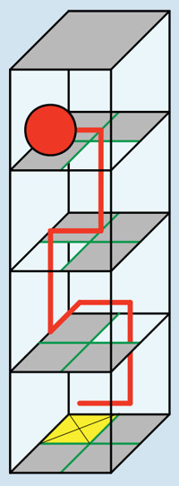

Mit Befehlsfolgen wie „OWNOW“ (siehe die rote Linie im Bild) oder „OWONW“ steuerst du die Kugel ins Ziel. Es gibt noch viele andere Möglichkeiten, die Kugel ins Ziel zu steuern, denn Umwege sind nicht verboten.

## Das ist Informatik!

Die Befehlsfolge, mit der die Kugel durch das Labyrinth gesteuert wird, ist ein kurzes Computerprogramm. Die zugehörige Programmiersprache kennt nur vier Befehle, nämlich N, O, S und W; in der Informatik spricht man auch von Anweisungen. Ein Programm in dieser Sprache ist eine Folge von Anweisungen, die nacheinander (in der Informatik sagt man auch sequenziell) ausgeführt werden. Auch bei den meisten „richtigen“ Programmiersprachen ist die Abfolge bzw. Sequenz von Anweisungen die grundlegendste Möglichkeit, einzelne Anweisungen zu einem Programm zu strukturieren. Weitere grundlegende Strukturierungsmöglichkeiten sind die Wiederholung, die Bedingte Anweisung sowie das Wiederverwenden von häufigen Programmteilen durch Unterprogramme. Und das genügt auch schon; auf diese scheinbar einfachen Strukturen lassen sich selbst die komplexesten Computerprogramme zurückführen.
