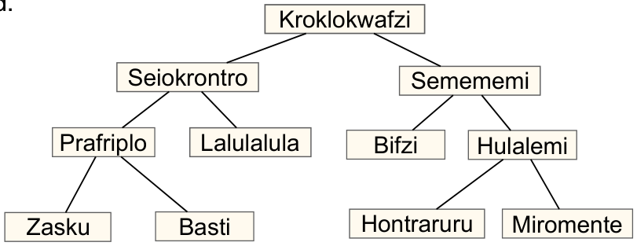

Das Bild beschreibt die Beziehungen zwischen Tierarten auf dem Planet Morgenstern. Eine Linie zwischen zwei Tierarten bedeutet, dass alle Tiere der unteren Art auch Tiere der oberen Art sind.

Beispielsweise sind alle Hulalemi auch Semememi. Manche Seiokrontro sind hingegen keine Basti.

**Nur eine der folgenden Behauptungen ist richtig. Welche?**
