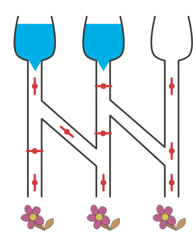

Wenn das Ventil zu ist (der rote Strich liegt quer zum Rohr), fließt kein Wasser. Wenn das Ventil offen ist (der rote Strich liegt längs im Rohr), fließt Wasser durch.

**Welche der drei durstigen Blumen bekommen Wasser bei dieser Stellung der Ventile?** Klicke auf die Blumen!

