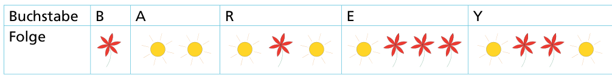

Barbara hat zwei Stempel bekommen. Einer druckt eine Blume, der andere eine Sonne. Sie überlegt, wie sie nur mit Blumen und Sonnen ihren Namen stempeln kann.

Für verschiedene Buchstaben bestimmt sie verschiedene Folgen von Blumen und Sonnen:

Ihren eigenen Namen „Barbara“ muss sie dann so stempeln:

Nun stempelt Barbara den Namen eines ihrer Freunde:

**Welchen Namen hat sie gestempelt?**
