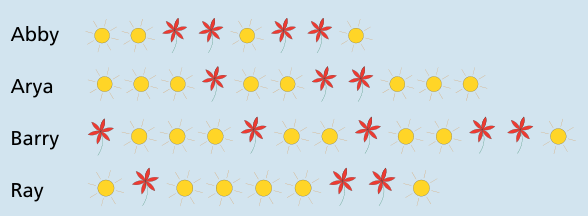

**Antwort A ist richtig:** Barbara stempelt die Namen ihrer Freunde so:

## Das ist Informatik!

Wenn Daten wie etwa die Buchstaben des Alphabets durch andere Daten (wie hier die Folgen von Blumen und Sonnen) beschrieben werden, spricht man in der Informatik von einer Codierung bzw. einem Code. Daten, die mit Hilfe von Computern gespeichert und verarbeitet werden sollen, werden binär codiert, also durch Folgen von 0- und 1-Werten: Textzeichen wie Buchstaben und Ziffern, Bilder, Musikstücke, Videos …

Ein solcher binärer Code ist einfach zu organisieren, wenn jedes Datenelement, also z. B. jedes Textzeichen, durch gleich viele Bits codiert werden kann. Lange Zeit war es üblich, ein Textzeichen durch 8 Bits zu kodieren – eine Folge von 8 Bits nennt man auch ein Byte. Neuere Codes wie UTF-8 setzen teilweise mehrere Bytes ein, um Zeichen aus Sprachen der ganzen Welt zu kodieren.

Hat man sehr viele Daten, ist es sinnvoll, sie platzsparend zu codieren. Textzeichen kommen in langen Texten unterschiedlich häufig vor; in deutschen Texten z. B. sind „E“ oder „N“ viel häufiger als „X“. Wenn man die häufigen Zeichen mit weniger Bits codiert als die seltenen, spricht man von einem Code mit variabler Länge. Damit man bei der Decodierung die Zeichen erkennen kann, darf die Codierung eines Zeichens niemals mit dem Anfang der Codierung eines anderen Zeichens übereinstimmen (überlege einmal, warum). Ein Code, der diese Regel einhält, heißt Präfixcode; ein bekanntes Beispiel ist der Morsecode.
