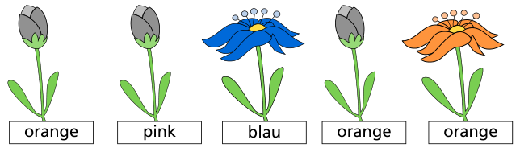
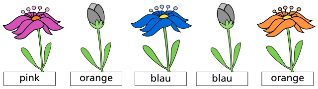

Jana spielt ein Computerspiel. Sie soll die Farben von fünf Blumen raten. Mögliche Farben sind blau, orange oder pink. Die Blumen sind geschlossen.

Jana rät zuerst die Farben so: orange, pink, blau, orange und orange. Sie hat zweimal richtig geraten. Die richtigen Blumen gehen auf:

Für die falschen Blumen rät sie andere Farben. Nun ist noch eine Blume richtig:

**Rate die Farben der beiden anderen Blumen.**
