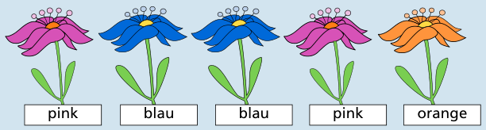

Für die Blumen links, in der Mitte und rechts stehen die Farben bereits fest: pink, blau und orange.

Bei der zweiten Blume von links hat Jana pink und orange bereits gewählt, aber beide Male falsch geraten. Von den drei möglichen Farben ist nur noch Blau übrig. Die Blume ist also blau.

Bei der zweiten Blume von rechts hat Jana orange und blau bereits gewählt, aber beide Male falsch geraten. Von den drei möglichen Farben ist nur noch Pink übrig. Die Blume ist also pink.

## Das ist Informatik!

Aus Ereignissen darf man logische Schlüsse ziehen. Aus einem Ereignis „Jana hat pink geraten, doch die Blume öffnet sich nicht“ darf man schließen, dass die Blume nicht pink ist. Logisch! Die Blumen können jede nur pink, orange oder blau sein. Nach Ereignissen, aus denen sich schließen lässt, dass eine Blume nicht pink und nicht orange ist, darf man schließen, dass diese Blume blau ist. Auch logisch!

Manche Menschen denken nicht gerne logisch. Es strengt an. Aber viele Menschen spielen zum Beispiel gerne Fußball, obwohl das auch anstrengt. Wenn man etwas gut kann, macht es Spaß. Wenn man es sehr gut kann, lässt sich mit logischem Denken sogar Geld verdienen, zum Beispiel als Schach-Profi. In der Informatik hat man Spaß am logischen Denken. Man programmiert es gern in Spiele hinein, wie bei dieser Biberaufgabe. Auch ist logisches Denken beim Arbeiten an Problemen der realen Welt nützlich – und beim Programmieren selbst. Faszinierend!
