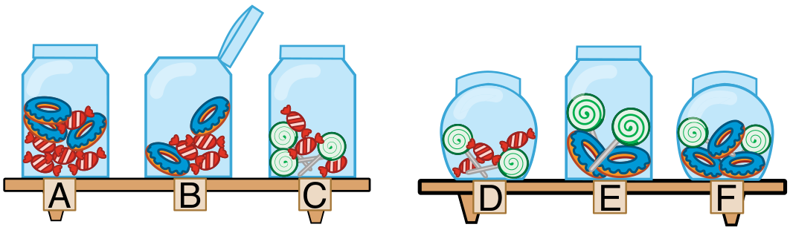

Eine Bonbonniere ist ein Glasgefäß für Süßigkeiten. Carl und Judy haben je drei davon. Jede Bonbonniere kann mehrere der folgenden zehn Eigenschaften haben:

- Die Bonbonniere ist offen (1) oder ist geschlossen (2).
- Die Bonbonniere enthält rot-weiß gestreifte Bonbons (3) oder enthält keine (4).
- Die Bonbonniere enthält blaue Zuckerringe (5) oder enthält keine (6).
- Die Bonbonniere enthält Lutscher mit grünen Spiralen (7) oder enthält keine (8).
- Die Bonbonniere ist rund (9) oder ist eckig (10).

Carls Bonbonniere A hat zum Beispiel die Eigenschaften 2, 3, 5, 8 und 10.

Schau genau hin! Carls Bonbonnieren haben einige Eigenschaften gemeinsam. Auch Judys Bonbonnieren haben einige Eigenschaften gemeinsam.

Eine der Bonbonnieren hat sogar sowohl die gemeinsamen Eigenschaften von Carls Bonbonnieren als auch die gemeinsamen Eigenschaften von Judys Bonbonnieren.

**Klicke auf diese Bonbonniere!**
