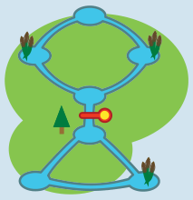
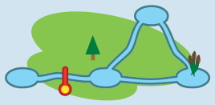
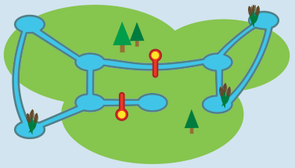

**Antwort B ist richtig:** Egal, welcher einzelne Bach durch einen Damm blockiert wird, können die Biber in diesem Revier noch von jedem Teich zu jedem anderen schwimmen.

In Revier A ist der Fluss in der Mitte ein Brücken-Bach. Ist er blockiert, können die Biber nicht mehr von unten nach oben schwimmen (und umgekehrt).

In Revier C ist der Bach links ein Brücken-Bach. Ist er blockiert, können die Biber nicht mehr zum linken Teich schwimmen.

In Revier D sind die beiden Bäche in der Mitte Brücken-Bäche.

## Das ist Informatik!

Das Biberrevier ist ein Netzwerk aus Bächen und Teichen. Das kann man mit dem Internet vergleichen. Dort sind Computer, Mobiltelefone, Fernseher etc. die Teiche. Leitungen oder Funkverbindungen sind die Bäche. Das Internet sollte ursprünglich Universitätsstandorte in den USA verbinden. Schon für die Gründer des Internets war es ein Thema, Brücken-Verbindungen zu vermeiden. Denn wenn eine Brücken-Verbindung ausfällt, sind Teile des Netzwerks abgetrennt.

Die Informatik bedient sich der Graphentheorie, um Netzwerke zu betrachten. Graphen werden als Systeme aus Knotenpunkten (Teiche) und Verbindungskanten (Bäche) definiert. Mit Graphen kann man viele Arten von Netzwerken modellieren, z. B. ein Verkehrsnetz oder ein Kommunikationsnetz.

In vielen Netzwerken ist es wichtig, dass jeder Knoten von jedem anderen Knoten aus erreichbar ist. Das Graphenmodell eines Netzwerks mit dieser Eigenschaft heißt „zusammenhängend“. Kanten, die in einem (Netzwerk-)Graphen vorhanden sein müssen, damit der Graph zusammenhängend bleibt, heißen „Brücken“. Die Brücken-Bäche im Biber-Teich-Bach-Netz sind genau solche Graphen-Brücken.

Die Informatik kennt viele Algorithmen, um Netzwerkprobleme zu analysieren. Eine ganze Reihe davon hat der amerikanische Informatiker Robert Tarjan erfunden. Von ihm stammt auch ein effizienter Algorithmus zur Bestimmung der Brücken in einem Graphen.
