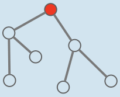
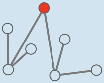

Dieser Plan erfüllt beide Bedingungen, nämlich:

- Vom roten Kreis aus ist jeder andere Kreis über höchstens zwei Linien zu erreichen.
- Von jedem Kreis führen höchstens zwei Linien weiter.

Aber auch andere Pläne erfüllen beide Bedingungen, zum Beispiel dieser:

Vielleicht brauchen die Biber noch weitere Bedingungen, um den allerbesten Plan zu erstellen.

## Das ist Informatik!

Die Burgen und Brücken bilden zusammen eine Struktur, in der von einem Knoten (nämlich Opas Burg) alle anderen Knoten (die anderen Burgen) auf genau einem Weg über Kanten (die Brücken) und andere Knoten erreicht werden können. Solch eine Struktur nennt die Informatik einen Baum. Der besondere Knoten (also Opas Burg) wird als Wurzel bzw. Wurzelknoten bezeichnet. Die Länge des weitesten Weges von der Wurzel eines Baums zu irgendeinem seiner Knoten, gemessen in der Anzahl der auf dem Weg passierten Kanten, nennt man die Höhe des Baums.

Bäume können für viele Anwendungen nützlich sein; sieh nach bei der Aufgabe „Mittagessen“ aus dem Informatik-Biber 2015. Besonders verbreitet ist ihre Anwendung als Suchbaum, in dem Werte einer möglicherweise sehr großen Menge (z. B. alle Wörter eines Wörterbuchs) an Knoten gespeichert werden. Um einen Wert zu suchen, geht man den Weg von der Wurzel zu seinem Knoten entlang. Die Suchen in einem Suchbaum sind also im Durchschnitt sehr viel schneller, wenn die Höhe möglichst klein ist.

Ein Baum, dessen Höhe begrenzt ist, nennt man auch balanciert. Der Biber-Brückenplan ist ein balancierter Baum, da seine Höhe durch die erste Bedingung ideal begrenzt wird.
