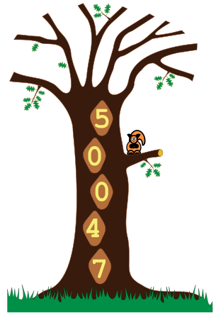
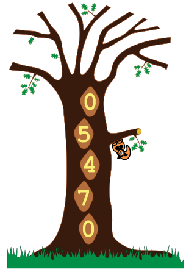

In einem Baum leben 16 egoistische Eichhörnchen. Nachts bewohnt jedes Eichhörnchen eine von fünf Baumhöhlen.

Die Eichhörnchen, die zusammen eine Höhle bewohnen, müssen sich das dort vorhandene Futter teilen. Jedes einzelne Eichhörnchen möchte deshalb für die nächste Nacht eine „bessere“ Höhle wählen. Es prüft dazu drei Zahlen, nämlich: für die aktuelle Höhle die Zahl seiner Mitbewohner und für die Höhlen unterhalb und oberhalb jeweils die Zahl der Bewohner. Für die nächste Nacht wählt es dann die Höhle mit dem niedrigsten Wert. Sind zwei Werte gleich, wählt das Eichhörnchen die aktuelle Höhle lieber als die Höhle oberhalb und die Höhle oberhalb lieber als die Höhle unterhalb.

Ein Beispiel: In einer Nacht bewohnen 5, 0, 0, 4 bzw. 7 Eichhörnchen die Höhlen (von oben nach unten). Für die nächste Nacht wählen alle 5 Eichhörnchen aus der obersten Höhle die Höhle unterhalb (denn 0 Mitbewohner sind besser als 4). Die 4 Eichhörnchen der zweiten Höhle von unten wählen die Höhle oberhalb (0 Nachbarn sind besser als 3). Auch die 7 Eichhörnchen der untersten Höhle wählen die Höhle oberhalb (4 Nachbarn sind besser als 6).

**In einer Nacht bewohnen 6, 3, 3, 0 und 4 Eichhörnchen die Höhlen (von oben nach unten). Nach wie vielen Tagen werden alle Eichhörnchen in derselben Höhle sein?**
