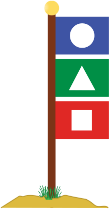

Albert ist Rettungsschwimmer und am Strand auf Posten. Seine Kinder Beatrix und Richard spielen weiter weg. Das Meer rauscht, der Wind übertönt alles Rufen und die Mobiltelefone finden kein Netz. Um doch mit den Kindern kommunizieren zu können, verwendet Albert eine Stange mit drei Positionen für farbige Flaggen.

Die obere Flagge kann folgendes bedeuten:

| Flagge | Bedeutung |
|---|---|
|  | Die Nachricht ist für Richard. |
|  | Die Nachricht ist für Beatrix. |
|  | Die Nachricht ist für Richard und Beatrix. |

Die mittlere Flagge kann folgendes bedeuten:

| Flagge | Bedeutung |
|---|---|
|  | Es gibt etwas zu essen. |
|  | Es gibt etwas zu trinken. |

Die untere Flagge kann folgendes bedeuten:

| Flagge | Bedeutung |
|---|---|
|  | Beeile dich! |
|  | Du kannst dir Zeit lassen! |

**Was bedeutet es, wenn diese Flaggen so an der Stange hängen?**
