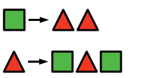
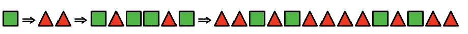
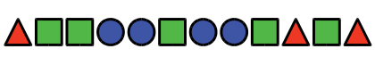

Alice spielt mit geometrischen Formen. In einer Reihe von Formen ersetzt sie nach und nach einzelne Formen durch eine Reihe anderer Formen.

Für jede Spielrunde überlegt sich Alice einige Ersetzungsregeln. Bei jeder Ersetzung wendet sie die Regeln so oft wie möglich an. Sie beginnt jede Spielrunde mit einer einzigen Form.

In einer ersten Spielrunde beginnt Alice mit einem Quadrat und hat sich diese Ersetzungsregeln überlegt:

Mit drei Ersetzungen produziert sie die Formenreihe rechts:

In einer anderen Spielrunde produziert Alice diese Formenreihe:

**Welche Ersetzungsregeln hat sie sich für diese Spielrunde überlegt?**
