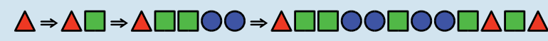

**Antwort A ist richtig:** Alice fängt mit einem Dreieck an und produziert die Formenreihe mit drei Ersetzungen:

Die anderen Antwortmöglichkeiten kann man durch die folgenden Überlegungen ausschließen:

**Antwort B:** Wenn Alice mit einem Dreieck oder einem Kreis beginnt, kann sie keine Quadrate produzieren. Wenn sie mit einem Quadrat beginnt, muss sie so ersetzen:

Da die Formenreihe mit jeder Ersetzung länger wird, kann sie die gewünschte Formenreihe mit diesen Regeln nicht produzieren.

**Antwort C:** Wenn Alice mit einem Dreieck beginnt, kann sie weder Quadrate noch Kreise produzieren. Wenn sie mit einem Quadrat beginnt, ersetzt sie so:

Nun hat sie keine Möglichkeit mehr, die beiden Dreiecke am Anfang durch ein Dreieck und ein Quadrat zu ersetzen, die am Anfang der gewünschten Formenreihe stehen. Auch wenn sie mit einem Kreis beginnt, stehen nach zwei Ersetzungen zwei Dreiecke am Anfang der produzierten Formenreihe:

**Antwort D:** Alice hat keine Möglichkeit, zwei Kreise nebeneinander zu produzieren. Es ist noch nicht einmal möglich, mehr als einen Kreis nebeneinander zu produzieren, da jeder Kreis bei der nächsten Ersetzung wieder in ein Quadrat und ein Dreieck umgewandelt würde. Die gewünschte Formenreihe enthält aber zwei Kreise nebeneinander.

## Das ist Informatik!

Die Symbole und Regeln des Formenspiels bilden zusammen ein System zur Veränderung von Symbolketten. In der theoretischen Informatik werden solche Ersetzungssysteme unter bestimmten Bedingungen auch als Grammatiken bezeichnet. Die Symbolfolgen, die, wie hier im Formenspiel, durch Anwendung der Regeln erzeugt werden können, sind dann die Wörter einer Sprache. In der theoretischen Informatik ist eine Sprache also eine Menge von Wörtern, und eine Grammatik erzeugt eine solche formale Sprache.

Für jede Grammatik lässt sich das Wortproblem als Frage formulieren: Gehört ein gegebenes Wort zu der von der Grammatik erzeugten Sprache? Wie schwer das Wortproblem zu lösen ist, hängt von der Form der Regeln der Grammatik ab. Aus der Form der Regeln ergeben sich Klassen von Grammatiken mit unterschiedlichen Eigenschaften. Zum Beispiel:

- Reguläre Grammatiken erzeugen Sprachen, die auch durch reguläre Ausdrücke beschrieben werden können und von endlichen Automaten erkannt werden; das Wortproblem ist also leicht zu lösen. Reguläre Grammatiken bzw. Ausdrücke sind sehr nützlich z. B. bei der Beschreibung von Suchmustern.
- Kontextfreie Grammatiken erzeugen Sprachen, für die das Wortproblem effizient gelöst werden kann. Programmiersprachen werden deshalb in der Regel durch kontextfreie Grammatiken beschrieben. Ein gültiges, vom Compiler akzeptiertes Programm ist aus formaler Sicht ein Wort der Sprache.
- Unbeschränkte Grammatiken erzeugen Sprachen, für die das Wortproblem nur zum Teil gelöst werden kann. Gehört ein Wort zu der von einer unbeschränkten Grammatik erzeugten Sprache, kann man eine Turingmaschine angeben, die dies erkennt. Die gleiche Turingmaschine würde aber nicht anhalten für ein Wort, das nicht zu der Sprache gehört.
