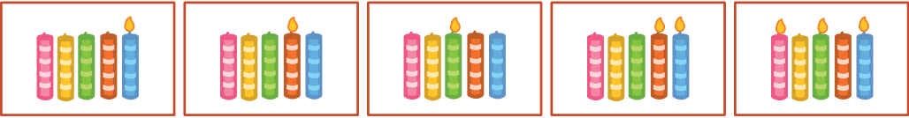

Heute ist Bodos elfter Geburtstag. Bodos Mutter findet aber nur noch fünf Kerzen. Zum Glück weiß sie, wie sie die Zahl elf mit fünf Kerzen darstellen kann. Sie steckt sie alle nebeneinander auf den Kuchen:

- Die Kerze ganz rechts ist 1 wert.
- Jede andere Kerze ist das Doppelte der Kerze rechts daneben wert.
- Die Werte aller brennenden Kerzen werden addiert.

Zum Beispiel:

**Welche Kerzen brennen an Bodos elftem Geburtstag?**
