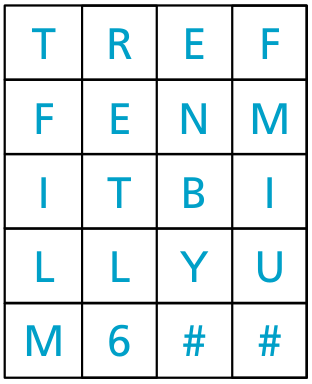

Boris und Berta senden sich geheime Nachrichten, die niemand außer ihnen verstehen soll.

Boris möchte Berta diesen Text mitteilen: TREFFENMITBILLYUM6

Boris schreibt die Zeichen des Texts nacheinander in die Felder einer Tabelle mit vier Spalten und fünf Zeilen. Dabei füllt er die Tabelle Zeile für Zeile von oben nach unten, in jeder Zeile von links nach rechts. In leere Felder am Ende der Tabelle schreibt Boris ein #. Das Bild zeigt das Ergebnis.

Nun nimmt Boris die Zeichen aus der Tabelle, aber diesmal Spalte für Spalte von links nach rechts, aus jeder Spalte von oben nach unten. Er sendet also diese geheime Nachricht: TFILMRETL6ENBY#FMIU#

Berta verwendet für ihre Antwort dieselbe Methode. Sie sendet folgende geheime Nachricht an Boris: OHDRIKWETNIEDS#CROE#

**Wie lautet Bertas Antwort?**
