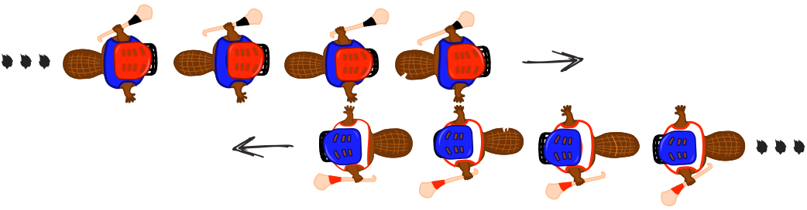

Biber spielen gerne das irische Spiel Hurling. Am Schluss einer Partie Hurling stellen sich beide Mannschaften hintereinander in einer Reihe auf. Dann laufen die Spieler aneinander vorbei, schütteln sich nach und nach die Hände und sagen „Danke für das Spiel!“.

Das Händeschütteln geht so: Zuerst schütteln sich die beiden ersten Spieler die Hände. Dann schütteln die ersten Spieler den zweiten Spielern der jeweils anderen Mannschaft die Hände (siehe Bild). Dies geht so weiter, bis auch die beiden letzten Spieler sich die Hände geschüttelt haben.

Beim Hurling gibt es 15 Spieler pro Mannschaft. Dass zwei Spieler sich die Hände schütteln und zum jeweils nächsten Spieler gehen, dauert 1 Sekunde.

**Wie viele Sekunden dauert das Händeschütteln der beiden Mannschaften insgesamt?**
