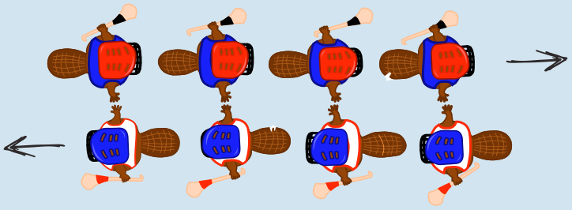

**29 ist richtig.** Wenn der erste Spieler den letzten Spieler erreicht und ihm die Hände geschüttelt hat, sind genau so viele Sekunden vergangen, wie jede Mannschaft Spieler hat. Bei Mannschaften mit vier Spielern sind das vier Sekunden, und die Spieler stehen dann so:

Die letzten Spieler haben dann dem ersten Spieler der jeweils anderen Mannschaft die Hände geschüttelt. Sie müssen danach noch allen weiteren Spielern der anderen Mannschaft die Hände schütteln. Bei vier Spielern pro Mannschaft dauert das noch einmal vier weniger eins gleich drei Sekunden.

Allgemein dauert das Händeschütteln in Sekunden also zweimal die Anzahl der Spieler einer Mannschaft weniger eins. Bei 15 Spielern pro Mannschaft dauert es folglich: (2 · 15) – 1 = 29 Sekunden.

## Das ist Informatik!

Für Hurling-Teams mit 15 Spielern konnten wir genau berechnen, wie lange ihr Händeschüttel-Algorithmus abläuft. 29 Sekunden sind für die Zuschauer gut auszuhalten. Doch wie sieht diese „Laufzeit“ z. B. bei Eishockey-Teams mit insgesamt 22 Spielern aus? Ist das Hurling-Händeschütteln dann immer noch brauchbar, oder würde es zu lange dauern? Es wäre gut, eine allgemeine Einschätzung der Laufzeit eines Algorithmus zu haben, anstatt Laufzeiten für bestimmte Werte einzeln zu überlegen.

Die Informatik befasst sich intensiv mit allgemeinen Einschätzungen von Algorithmen-Laufzeit. Solche Laufzeitanalysen liefern einen mathematischen Ausdruck, der eine Variable *n* für die Größe der Eingabe enthält. Für das Hurling-Händeschütteln erhalten wir einen solchen Ausdruck, wenn wir im vorletzten Satz der Antworterklärung „Anzahl der Spieler einer Mannschaft“ durch *n* ersetzen: 2*n* – 1. Damit lässt sich auch für andere Spielerzahlen die Händeschüttel-Laufzeit berechnen: für 22 Spieler 43 Sekunden, für 40 Spieler 79 Sekunden usw.

Hinter dem Laufzeitausdruck 2*n* – 1 steckt eine lineare Funktion. Damit gehört der Hurling-Händeschüttel-Algorithmus zur Klasse der Algorithmen mit linearer Laufzeit, die man auch als O(*n*) bezeichnet. Ein Händeschüttel-Algorithmus, bei dem jeder jedem anderen nacheinander die Hand gibt, wäre weniger schnell. Er gehörte zur Klasse O(*n*²), und mit einem Händeschüttel-Algorithmus dieser Klasse könnten die Hurling-Teams in der Größenordnung von 15² = 225 Sekunden benötigen. Das sind fast vier Minuten – gähn! Es lohnt sich also darüber nachzudenken, ob man Dinge parallel, also gleichzeitig erledigen kann – wie die Hurler beim Händeschütteln.
