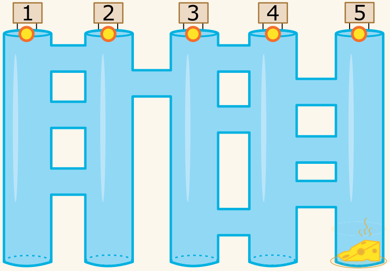

Eine Maus steht oben vor fünf langen Gängen. Zwischen den langen Gängen gibt es kurze Quergänge. Die Maus möchte zum Käse unten am Ende vom langen Gang ganz rechts.

Auf ihrem Weg durch die Gänge befolgt die Maus immer abwechselnd diese Anweisungen:

1. Laufe durch den langen Gang nach unten, bis ein Quergang kommt.
2. Laufe durch den Quergang.

**In welchen langen Gang muss die Maus hineinlaufen, damit sie zum Käse kommt?**
