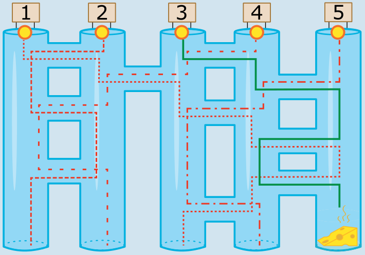

Die Maus muss in **Gang 3** hineinlaufen, damit sie zum Käse kommt. Die grüne Linie zeigt, wie sie läuft.

Wenn die Maus in einen anderen Gang hineinläuft, kommt sie nicht zum Käse. Die roten gestrichelten Linien zeigen die falschen Wege:

- Läuft sie in Gang 1 hinein, kommt sie ans Ende von Gang 3.
- Läuft sie in Gang 2 hinein, kommt sie ans Ende von Gang 1.
- Läuft sie in Gang 4 hinein, kommt sie ans Ende von Gang 2.
- Läuft sie in Gang 5 hinein, kommt sie ans Ende von Gang 4.

## Das ist Informatik!

Die Maus hat klare Anweisungen, wie sie durch die Käsegänge laufen soll. Die Anweisungen sagen der Maus, wie sie auf bestimmte Ereignisse reagieren soll. Das kann man leicht erkennen, wenn die Anweisungen anders ausgedrückt werden:

- Wenn das Ereignis eintritt, dass du in einen langen Gang hineinkommst, laufe den langen Gang hinunter.
- Wenn das Ereignis eintritt, dass du an einen Quergang kommst, laufe durch den Quergang.

Viele Computerprogramme müssen auf Ereignisse reagieren. Besonders wichtig ist das bei dem Teil eines Computerprogramms, das seine Benutzung durch Menschen regelt: der Mensch-Computer-Schnittstelle, auf Englisch meist Graphical User Interface (GUI) genannt. Dieser Programmteil muss festlegen, was passiert, wenn mit der Maus oder dem Finger etwas angeklickt wird, auf dem Bildschirm gezeigte Objekte bewegt werden oder mit der Tastatur ein Buchstabe getippt wird.

Da für sehr viele Programme ein GUI benötigt wird, hat die Informatik einen passenden Programmierstil entwickelt, das ereignis-getriebene Programmieren (englisch: event-driven programming). Programmierwerkzeuge, die diesen Stil unterstützen, helfen Programmiererinnen und Programmierern dabei, gute GUIs zu erstellen.
