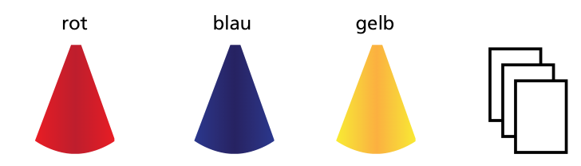
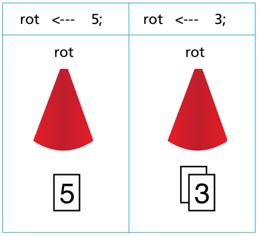

Der Biber spielt mit Karten, auf die er Zahlen schreibt. Die Karten stapelt er unter farbigen Kegeln. Wenn er einen Kegel anhebt, sieht er nur die oberste Karte des Stapels.

Der Biber schreibt in dieser Form auf, was er tut:

Nun bist du dran. Der Biber schreibt:

`rot <--- 3; gelb <--- 5; rot <--- 6; gelb <--- 8; blau <--- 1; gelb <--- 3;`

**Welche Karten sieht der Biber, wenn er die Kegel anhebt?**
