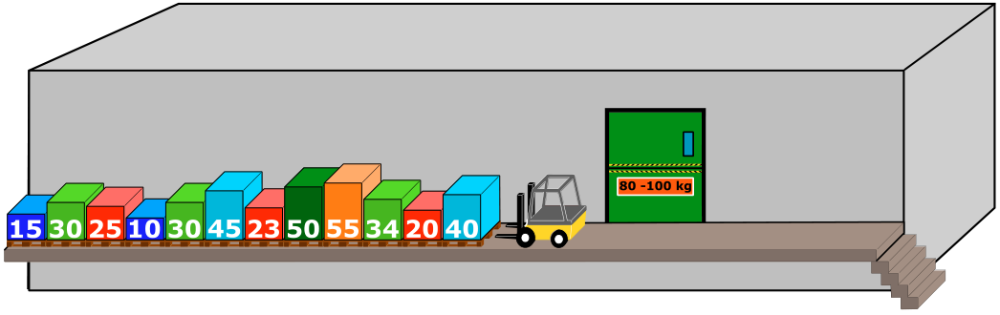

Von einer Laderampe aus führt ein Lift in einen Keller. Auf einer Seite der Laderampe stehen eine Reihe Kisten. Die Kisten wiegen, von links nach rechts in kg (Kilogramm): 15, 30, 25, 10, 30, 45, 23, 50, 55, 34, 20, 40.

Die Kisten sollen in den Lift geladen und damit in den Keller gebracht werden. Der Lift macht eine Fahrt, sobald seine Ladung mindestens 80 kg und höchstens 100 kg wiegt. Er kommt danach leer wieder zurück.

Die Laderampe ist so eng, dass Kisten nicht aneinander vorbei gehoben werden können. Deshalb wird immer die vorderste Kiste der Reihe als nächste bearbeitet (das ist die Kiste, die dem Lift am nächsten steht). Diese Kiste wird nur in den Lift geladen, falls danach dessen Ladung höchstens 100 kg wiegt. Andernfalls wird die Kiste auf der anderen Seite der Laderampe in einer neuen Reihe abgestellt.

Wenn alle Kisten der Reihe bearbeitet worden sind, werden die Kisten, die nun auf der anderen Seite der Laderampe in einer Reihe stehen, genau so bearbeitet.

Alle Kisten werden nun auf die beschriebene Weise mit dem Lift in den Keller gebracht.

**Welche der folgenden Aussagen ist richtig?**
