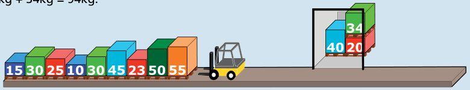
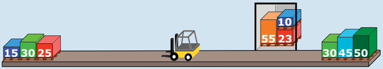
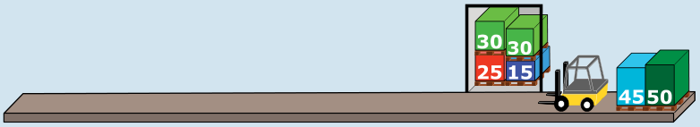

**Antwort C ist richtig:** Bei der ersten Fahrt besteht die Ladung aus den ersten drei Kisten und wiegt 40 kg + 20 kg + 34 kg = 94 kg.

Für die zweite Fahrt wird zuerst die nächste Kiste (55 kg) in den Lift geladen. Die folgende Kiste (50 kg) kann nicht in den Lift geladen werden (55 kg + 50 kg > 100 kg) und wird auf der anderen Seite der Laderampe abgestellt. Die nächste Kiste (23 kg) wird in den Lift geladen; die Ladung ist aber noch zu leicht: 55 kg + 23 kg = 78 kg. Die nächste Kiste (45 kg) kann nicht in den Lift geladen werden (zu schwer) und wird auf der anderen Seite der Laderampe abgestellt. Dasselbe geschieht mit der nächsten Kiste (30 kg). Schließlich kann die nächste Kiste (10 kg) in den Lift geladen werden. Der Lift macht seine zweite Fahrt mit einer Ladung von 55 kg + 23 kg + 10 kg = 88 kg.

Die letzten drei Kisten der Reihe (25 kg + 30 kg + 15 kg = 70 kg) werden ebenfalls in den Lift geladen. Nun werden die Kisten auf der anderen Seite der Laderampe bearbeitet. Die erste Kiste dieser Reihe (30 kg) wird in den Lift geladen, der mit einer Ladung von genau 100 kg seine dritte Fahrt macht.

Zu diesem Zeitpunkt sind nur noch zwei Kisten auf der anderen Seite der Laderampe übrig: 45 kg + 50 kg = 95 kg. Der Lift macht mit diesen Kisten seine vierte Fahrt.

Die Ladung der dritten Fahrt wiegt 100 kg; die Aussage C ist also richtig. Die Aussagen A, B, D und E sind nicht richtig, wie die Erklärung zeigt.

## Das ist Informatik!

In der Informatik gibt es einige elementare Datenstrukturen, die sich immer wieder für die Modellierung einer Anwendung gut eignen. Eine Datenstruktur, die man auf jeden Fall kennen sollte, ist der „Stapel“ (englisch „stack“). Ein Stapel kann beliebig viele Elemente enthalten; besonders wichtig ist das oberste Element.

In dieser Biberaufgabe gibt es zwei Stapel. Man erkennt sie vielleicht auf den ersten Blick nicht, weil sie quer liegen. Der eine Stapel ist die erste Kistenreihe, die zu Beginn alle 12 Kisten enthält. Ihr oberstes Element ist die Kiste, die 40 kg wiegt. Der zweite Stapel ist die Kistenreihe auf der anderen Seite der Laderampe, die sich beim Verladen bildet. Zu Beginn ist dieser Stapel leer, er enthält keine Elemente und ist darum noch unsichtbar.

An einem Stapel sind nur zwei Handlungen erlaubt:

1. Lege ein Element oben auf den Stapel.
2. Nimm das oberste Element vom Stapel weg.

Sie werden traditionell gerne PUSH und POP genannt. Auf der Laderampe werden PUSH und POP vom Gabelstapler ausgeführt.
