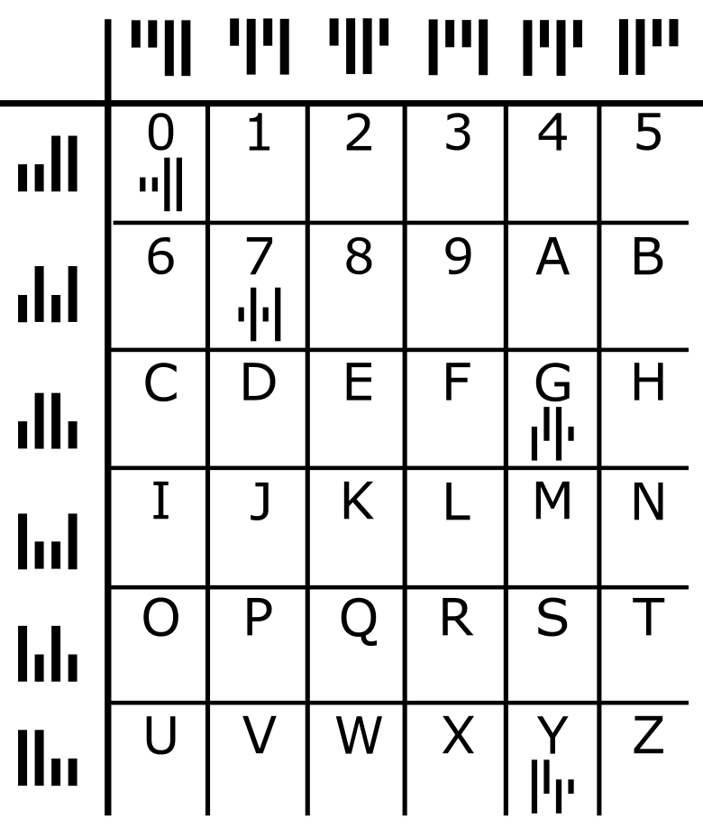
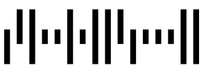
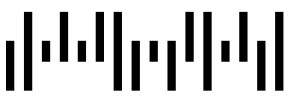

In den Biberlanden sind die Postleitzahlen vierstellig und enthalten Buchstaben und Ziffern. Es gibt sogar einen eigenen Strichcode für die Postleitzahlen, den Kix-Code. In jedem Zeichen des Kix-Codes gibt es einen oberen Teil, zwei lange und zwei kurze Balken, und einen unteren Teil, ebenfalls zwei lange und zwei kurze Balken. In der Mitte überdecken sich die Balken.

In der Tabelle siehst du die Kix-Code-Zeichen für 0, 7, G und Y. Der obere Teil eines Zeichens steht über seiner Spalte, der untere Teil vor seiner Zeile.

Für die biberländische Postleitzahl G7Y0 steht also dieser Kix-Code:

**Für welche Postleitzahl steht dieser Kix-Code?**

