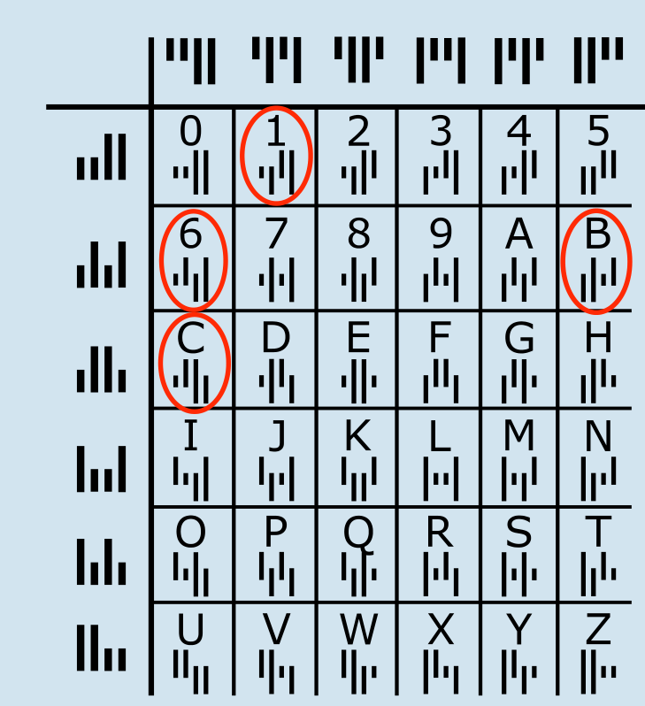

**BC16 ist richtig:** Der gefragte Kix-Code besteht aus vier Kix-Code-Zeichen:

Das Bild zeigt die Tabelle aus der Aufgabenstellung, aber nun mit den Kix-Code-Zeichen für alle Buchstaben und Ziffern. In der Tabelle kann man die Bedeutung der vier Zeichen des gefragten Kix-Codes nachschauen. Gesucht sind B, C, 1 und 6 (die rot umrandeten Zeichen).

## Das ist Informatik!

Maschinenlesbare grafische Codes ermöglichen es, vieles automatisch zu erledigen, wo vorher Menschen an Fließbändern arbeiteten; zum Beispiel um Briefe und Pakete zu sortieren. Der Barcode („Bar“ ist das englische Wort für „Balken“) kommt unter anderem in Supermärkten an den Laserscanner-Kassen zum Einsatz. Der QR-Code wurde für die Autoindustrie entwickelt, um Bauteile zu kennzeichnen. Mittlerweile ist der QR-Code auch überall in der Werbung zu finden. Es gibt kostenlose Smartphone-Apps zum Scannen der Codes und Ausgeben deren Botschaften.

Die Informatik befasst sich mit der Verarbeitung und damit auch der Übertragung von Information – wie der Name schon sagt. Information muss aber nicht nur von Computer zu Computer übertragen werden, sondern auch aus der realen Welt in die virtuelle Welt der Computer. Ob Kix-Code, Barcode oder QR-Code: Grafische Codes machen diese Übertragung einfacher – und reichhaltiger. An der Supermarkt-Kasse muss kein Preis mehr vom Preisschild abgetippt werden, seitdem es Barcodes und Barcode-Scanner gibt. Und da der Barcode mehr Information enthält als nur den Preis, weiß der Supermarkt-Computer gleich, welche Ware verkauft wurde.

Übrigens: In den Niederlanden wird der Kix-Code tatsächlich bei der Post verwendet, allerdings mit ein paar Zeichen mehr.
