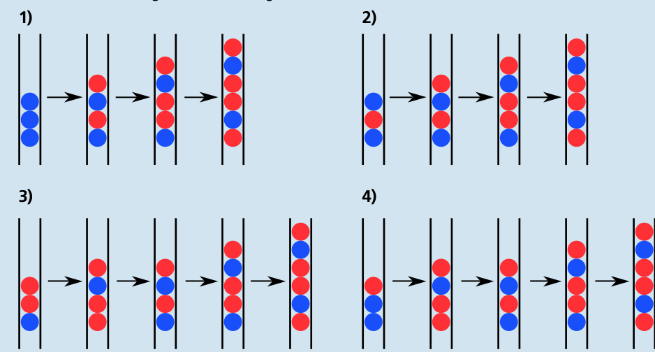
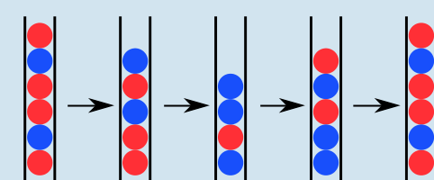

---
answers:
  - [[1], [1], [2]]
  - [[1], [2], [2]]
  - [[2], [1], [2]]
  - [[2], [2], [2]]
---
Wenn die unterste Kugel einer Dreierfolge rot ist, endet das Spiel schon nach dem ersten Klick: Dann sind nur noch zwei Kugeln in der Röhre.

Hingegen ist jede Dreierfolge, deren unterste Kugel blau ist, eine Endlos-Folge. Mit höchstens vier Klicks wird nämlich aus jeder der vier möglichen Dreierfolgen mit unterster blauer Kugel die Sechserfolge rot-blau-rot-rot-blau-rot:

Nach weiteren vier Klicks entsteht dann wieder diese Folge, und so geht es endlos weiter.

## Das ist Informatik!

Emil Leon Post (1897–1954) war ein polnischer Mathematiker und Logiker, der viele wissenschaftliche Beiträge zur theoretischen Informatik auf dem Gebiet der Aussagenlogik veröffentlichte. Das in dieser Biberaufgabe vorgestellte Spiel wurde von Post als Beispiel verwendet, um zu zeigen, dass es bei Systemen, in denen Symbolketten anhand bestimmter Regeln manipuliert werden, zu nicht abbrechenden Prozessen kommen kann.

In solchen Systemen werden Teile von Symbolketten durch andere Symbolketten ersetzt. Sie werden in der theoretischen Informatik auch als Ersetzungssysteme bezeichnet. Die möglichen Ersetzungen werden durch eine endliche Menge von Regeln vollständig bestimmt. Die Umformungen, die ein Ersetzungssystem ermöglicht, können als eine Art von Berechnung angesehen werden – und damit werden sie für die Informatik wichtig. Für die von Post erfundenen Ersetzungssysteme wie auch für andere Arten von Ersetzungssystemen, etwa die so genannten Semi-Thue-Systeme, konnte nachgewiesen werden, dass sie – als Berechnungsmechanismus – gleichwertig zu Turingmaschinen sind. Das bedeutet aber auch, dass es Fragen gibt, die für Ersetzungssysteme nicht entschieden werden können: Das Halteproblem der Turingmaschine entspricht hier dem Wortproblem; beide sind nicht entscheidbar.
