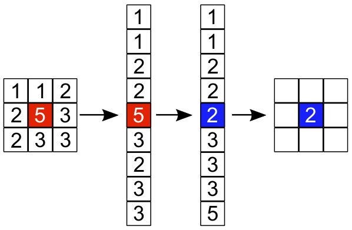
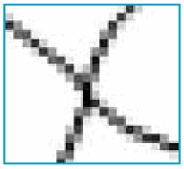

Ein Bild wird als Tabelle gespeichert, mit Grauwerten von 1 bis 5 für jedes Pixel. Der Grauwert 1 steht für Schwarz, der Grauwert 5 steht für Weiß, die Grauwerte von 2 bis 4 stehen für die heller werdenden Grautöne dazwischen.

Ein Algorithmus „Medianfilter“ berechnet aus einem ursprünglichen Bild ein gefiltertes Bild gleicher Größe. Dazu werden für jedes Pixel aus dem ursprünglichen Bild …

- … sein Grauwert und die acht Grauwerte seiner acht Nachbar-Pixel …
- … aufsteigend sortiert in einer Reihe aufgeschrieben …
- … und der mittlere, also fünfte Wert von neun, …
- … als Grauwert des gleichen Pixels im gefilterten Bild genommen.

Das Bild zeigt, wie der Medianfilter aus dem Grauwert 5 eines Pixels im ursprünglichen Bild den Grauwert 2 für das gleiche Pixel im gefilterten Bild berechnet.

**Wie wird das gefilterte Bild aussehen, wenn der Medianfilter dieses ursprüngliche Bild verarbeitet hat?**

