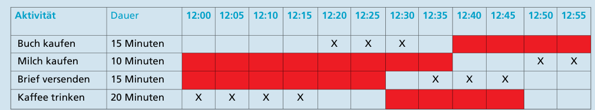

Die richtige Reihenfolge ist: Kaffee trinken, Buch kaufen, Brief versenden, Milch kaufen.

Dieses Problem weist einige Einschränkungen auf. Wenn man sie in einer Tabelle darstellt, sieht das so aus (rot: Stoßzeit):

Alexandra muss vor 12:40 Uhr in der Buchhandlung gewesen sein. Sie muss das Lebensmittelgeschäft nach 12:40 Uhr besuchen. Die Post kann sie erst nach 12:30 Uhr besuchen. Sie muss die Cafeteria vor 12:30 Uhr besuchen, weil sie nach 12:50 Uhr nicht mehr genügend Zeit für ihre Pause hat. Der einzige mögliche Zeitplan ist also (in der Tabelle oben mit „X“ markiert): Kaffee trinken: 12:00 Uhr–12:20 Uhr; Buch kaufen: 12:20 Uhr–12:35 Uhr; Brief versenden: 12:35 Uhr–12:50 Uhr; Milch kaufen: 12:50 Uhr–13:00 Uhr.

## Das ist Informatik!

Ein Problem ist nur dann gut gelöst, ein Auftrag ist nur dann wirklich erledigt, wenn alle gegebenen Einschränkungen (Constraints) eingehalten wurden. Je nach Anwendungsfall kann alles Mögliche eine Einschränkung sein.

Für einen mobilen Roboter kann es ein Gegenstand auf seinem Weg sein, für einen Manager kann es das seinem Projekt zugeteilte Geld sein. In dieser Biberaufgabe sind für Alexandra die Zeiträume einschränkend, zu denen eine besonders große Zahl anderer Kunden zu erwarten ist – die Stoßzeiten.

Für die Informatik ist das Lösen von Problemen unter Einschränkungen ein spannendes Thema. Die unterschiedlichen Anwendungsfälle fordern immer wieder zu kreativen Planungen heraus: Wenn es mehrere Lösungen gibt, welche ist die optimale? Wenn es keine Lösung gibt, welche minimalen Änderungen der Einschränkungen würde eine maximale Teillösung erlauben?

Es kommt noch hinzu, dass die reale Welt nicht still steht und die bisherigen Einschränkungen sich ändern können. Wenn viele Kunden sich wie Alexandra verhalten, verschieben sich die Stoßzeiten. Für alles Planen gilt (nicht nur in der Informatik): Erwarte stets das Unerwartete.
