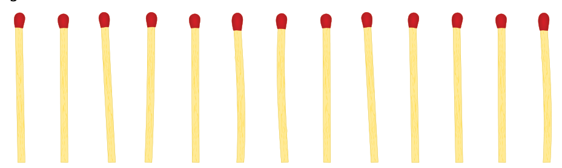

Beat und sein Freund spielen das Nim-Spiel. 13 Hölzchen liegen auf dem Tisch. Die beiden Spieler nehmen abwechselnd 1, 2 oder 3 Hölzchen weg. Wer das letzte Hölzchen nimmt, hat gewonnen.

Hinweis: Wenn noch vier Hölzchen auf dem Tisch liegen, kann Beat nicht mehr gewinnen. Diese Situation möchte er vermeiden.

**Beat fängt an. Wie viele Hölzchen muss er wegnehmen, um das Spiel zu gewinnen?**
