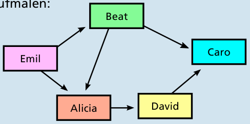

Die Reihenfolge ist: Emil → Beat → Alicia → David → Caro.

Zur Begründung kann man sich die „will wissen, ob der andere zur Party kommt“-Beziehungen zwischen Sarahs Freunden mit Pfeilen so aufmalen:

Von z. B. Alicia zu David geht ein Pfeil, weil David ja eben wissen will, ob Alicia zur Party kommt; die anderen Pfeile haben eine entsprechende Bedeutung. Damit entsteht das Bild eines Graphen, mit den Personen als Knoten und den „Bedingungen“ als gerichtete Kanten. Um ihr Reihenfolge-Problem zu lösen, muss Sarah einen Weg durch den Graphen finden, der von einem Knoten zum anderen in Pfeilrichtung an den Kanten entlang geht (damit berücksichtigt sie die Wissbegier ihrer Freunde) und auf dem sie alle Knoten besucht (sie will ja alle ihre Freunde ansprechen). Die oben gezeigte Abfolge Emil → Beat → Alicia → David → Caro ist so ein Pfad, und dies ist außerdem der einzige Pfad.

## Das ist Informatik!

Es passiert im Leben häufig, dass man Dinge erst tun kann, wenn man die Voraussetzungen dafür geschaffen hat. Ein gutes Beispiel ist das Kochen: Spagetti sollte man erst dann ins Wasser geben, wenn man es zum Kochen gebracht und Salz hineingeschüttet hat. Die Bolognese sollte man erst dann auf die Spagetti geben, wenn die Spagetti gar sind. Aber ob man die Spagetti und die Bolognese nacheinander oder gleichzeitig kocht, ist egal (vorausgesetzt, man hat genug Kochstellen auf dem Herd). Die Party-Einladung und das Kochen kann man selbst planen. Bei Abläufen mit vielen Schritten und vielen Bedingungen verlieren Menschen aber leicht die Übersicht. Da hilft die Informatik. Computerprogramme für Ablaufplanung (englisch: Scheduling) werden beispielsweise in der Industrie eingesetzt. Komplexe Abläufe wie der Bau eines Autos können so möglichst effizient, also zum Beispiel ohne unnötiges Warten auf Bauteile, gestaltet werden. Damit spart man viel Geld, weil man kein großes Lager mehr benötigt und Maschinen möglichst pausenlos arbeiten können.
