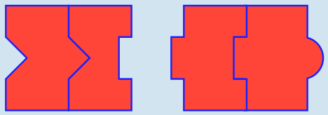

Diese beiden Pärchen kann man gleichzeitig bilden:

Aus fünf Steinen können höchstens zwei Pärchen gleichzeitig gebildet werden.

Es ist verführerisch, aus den beiden Steinen links sofort ein Pärchen zu bilden. Doch dann bleibt dieses das einzige Pärchen.

Es gibt neben dem gezeigten Paar von Pärchen noch zwei weitere Möglichkeiten (Stein 3 mit Stein 1 und Stein 2 mit Stein 4 sowie Stein 1 mit Stein 4 und Stein 2 mit Stein 5); jede davon ist richtig.

## Das ist Informatik!

Viele Menschen machen Dinge gerne optimal: sie laufen so schnell wie möglich, suchen den kürzesten Weg von einem Ort zum anderen, verdienen möglichst viel Geld – oder bilden so viele Puzzlestein-Pärchen wie möglich. Weil es bei den Puzzlesteinen nicht so viele Möglichkeiten gibt, Pärchen zu bilden, kann man in Ruhe alle ausprobieren.

Wenn Computer für die Suche nach optimalen Lösungen verwendet werden, müssen sie meistens viele Daten verarbeiten. Dann würde die Methode „alles ausprobieren“ viel zu lange dauern. Die Informatik kennt deshalb noch viele andere Methoden zur Suche nach optimalen Lösungen. Eine davon heißt „greedy“, auf Deutsch: gierig. Die Greedy-Methode führt immer denjenigen nächsten Schritt aus, der am meisten Zugewinn bei der Lösung verspricht. Bei den Puzzlesteinen würde die Greedy-Methode die beiden Steine links zusammenschieben.

Das Schöne an der Informatik ist, dass es meistens nichts nutzt, gierig zu sein: die optimale Lösung wird „greedy“ nicht gefunden. Das ist auch bei den Puzzlesteinen so: Man muss alle sinnvollen Möglichkeiten betrachten, um zwei Pärchen bilden zu können.
