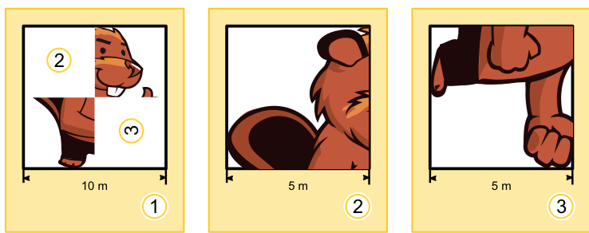
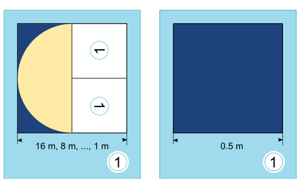

Tina und Ben helfen bei der Vorbereitung einer Sonderausstellung im Informatik-Museum. Auf den Boden eines Ausstellungsraums sollen sie ein 16 × 16 Meter großes Bild malen. Vom Künstler bekommen sie einen Satz Malanweisungskarten in dessen berühmter Malkartensprache, mit Hinweisen zu den Bildelementen, Maßen und Drehungen. Auf manchen Malanweisungskarten sind nummerierte Felder, die auf andere Malanweisungskarten verweisen.

Hier ein Beispiel aus einem früheren Malkartenprojekt. Wenn man diese drei Malanweisungskarten richtig ausführt, entsteht ein Bild des Bibers:

Für die Sonderausstellung bekommen Tina und Ben nun die folgenden zwei Malanweisungskarten:

Ben runzelt die Stirn. „Wie soll das gehen? Die linke Karte verweist auf sich selbst, und außerdem haben beide Karten die selbe Nummer!“ Tina lacht: „Wir kriegen das hin! Zuerst verwenden wir nur die linke Karte. Die rechte Karte wird uns später anweisen, wann wir mit dem Malen aufhören sollen.“

**Wie wird der Boden des Ausstellungsraums aussehen?**
