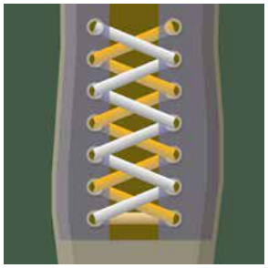

Falco liebt seine Schuhbänder, die zur Hälfte orange und zur Hälfte weiß sind. Er lässt sich immer neue, komplizierte Schnürungen einfallen und findet sich damit sehr cool. Damit er keine Schnürung vergisst, schreibt er auf, wie er sie hergestellt hat. Dazu verwendet er eine Programmiersprache, die genau sagt, wie das Band durch die Ösen laufen soll.

Hier ist eines von Falcos Schnürungs-Programmen (6 Zeilen lang):

```
01  orange: von_unten
02  weiss:  von_unten
03  {
04  orange: hoch wechseln von_unten
05  weiss:  hoch wechseln von_unten
06  }
```



Dieses Programm erzeugt die Schnürung im Bild. Wie bei jeder Schnürung geht es bei den Ösen in der untersten Reihe los, mit weiß auf der linken Seite und orange auf der rechten Seite.

Für die Schnürungs-Programmiersprache hat Falco sich insgesamt folgende Befehle und Strukturen überlegt:

| Befehl | Bedeutung |
|---|---|
| `orange:` | Das Folgende gilt für die orange Hälfte des Schuhbands. |
| `weiss:` | Das Folgende gilt für die weiße Hälfte des Schuhbands. |
| `von_unten` | Das Band wird von unten durch die aktuelle Öse gesteckt. |
| `von_oben` | Das Band wird von oben durch die aktuelle Öse gesteckt. |
| `hoch` | Das Band geht eine Öse nach oben (gleiche Seite, nächste Reihe). |
| `wechseln` | Das Band geht zur Öse auf der anderen Seite, in der gleichen Reihe. |
| `{...}` | Was zwischen den Klammern steht, wird so oft wie möglich wiederholt. |
| `*N {...}` | Was zwischen den Klammern steht, wird genau N-mal wiederholt. |

**Welche Schnürung erzeugt dieses Programm?** (Es ist 12 Zeilen lang.)

```
01  orange: von_unten
02  weiss:  von_unten
03  *2 {
04  orange: hoch wechseln von_unten
05  weiss:  hoch wechseln von_unten
06  }
07  orange: hoch von_oben
08  weiss:  hoch von_oben
09  {
10  orange: hoch wechseln von_unten
11  weiss:  hoch wechseln von_unten
12  }
```
