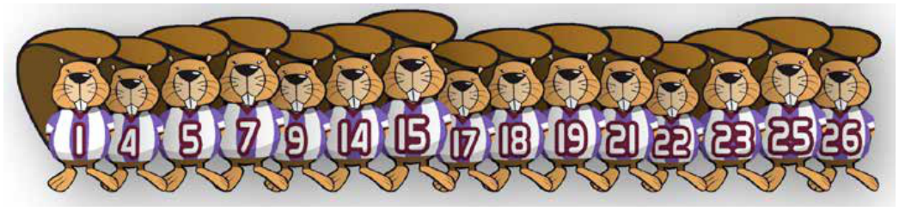
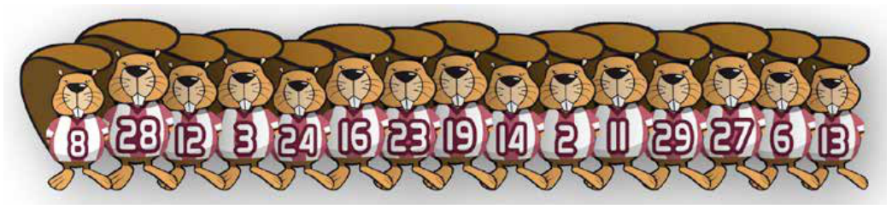

Die Bilder zeigen zwei Teams mit je 15 Spielern. Die Trikots der Spieler sind mit den Spielernummern bedruckt.

Die Spieler von Team 1 stehen nach ihren Spielernummern sortiert:

Die Spieler von Team 2 stehen nicht sortiert:

Nun erhältst du den Auftrag festzustellen, wie viele Spielernummern sowohl in Team 1 als auch in Team 2 vorkommen.

**Wie kannst du den Auftrag möglichst schnell erledigen?**
