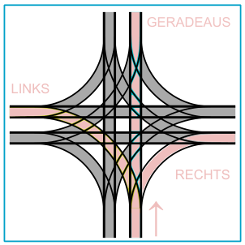
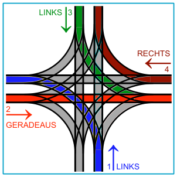

Auf den Straßen von Sankt Petersburg (Russland) fährt die Trambahn. An einer Trambahnkreuzung dort ist alles möglich: Die Trambahnen können aus allen vier Richtungen herkommen und auf alle möglichen Arten weiterfahren. Die Stellung der Weichen bestimmt, wie die Trambahnen weiterfahren. Die Weichenstellung wird so beschrieben: Im Uhrzeigersinn wird für jede Herkunftsrichtung angegeben, wie die Trambahnen weiterfahren: GERADEAUS, nach RECHTS oder nach LINKS.

Ein Beispiel: LINKS-GERADEAUS-LINKS-RECHTS bedeutet, dass die Trambahnen aus Richtung 1 nach links abbiegen, die Trambahnen aus der im Uhrzeigersinn nächsten Richtung 2 geradeaus fahren, und so weiter.

Allerdings kann es bei dieser Weichenstellung leicht zu Zusammenstößen kommen: von Bahnen aus den Richtungen 1 und 2, oder von Bahnen aus den Richtungen 2 und 3.

**Auch bei einer der folgenden Weichenstellungen kann es leicht zu Zusammenstößen kommen. Bei welcher?**
