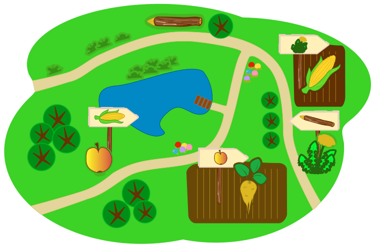

Biber Kati möchte einen Bibersalat machen. Kati muss fünf Zutaten in die Schüssel tun.

Im Garten findet Kati die Zutaten. Bei jeder Zutat zeigt ein Schild, welche Zutat sie als nächste in die Schüssel tun muss. Zum Beispiel muss sie nach dem Apfel den Mais in die Schüssel tun.

**Welche Zutat muss Kati als erste in die Schüssel tun?**
