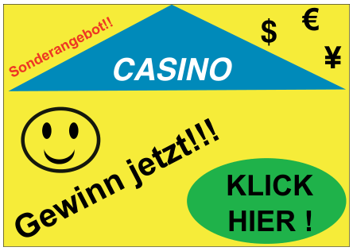

Julie bekommt diese Werbung mit einer E-Mail:

Sie will unbedingt auch gewinnen. In der Schule hat sie aber gehört, dass nur Erwachsene im Glücksspiel mitmachen dürfen, dass man nur selten gewinnt und dass obendrein die persönlichen Daten der Spieler missbraucht werden können.

**Was soll sie machen?**
