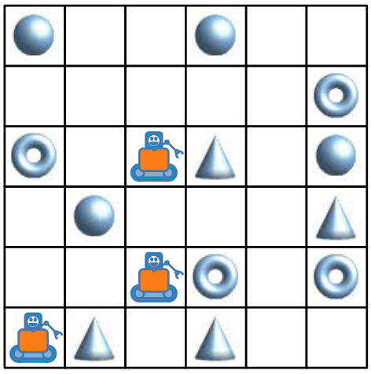

Drei Roboter arbeiten als Team zusammen. Du kannst das Team mit Richtungsbefehlen steuern: N, S, O oder W (Norden oben, Osten rechts). Mit einem Richtungsbefehl steuerst du alle drei Roboter gleich: um ein Feld weiter in diese Richtung.

Du sollst die Roboter zu den Dingen steuern, die sie am Ende nehmen sollen. Damit sie nichts Falsches nehmen, musst du sie vorher um andere Dinge herum steuern.

Ein Beispiel: Du steuerst die Roboter mit diesen Befehlen: N, N, S, S, O. Dann nehmen die Roboter am Ende zwei Kegel und einen Ring.

Die Roboter sollen einen Ball, einen Ring und einen Kegel nehmen.

**Mit welchen Befehlen musst du sie steuern?**
