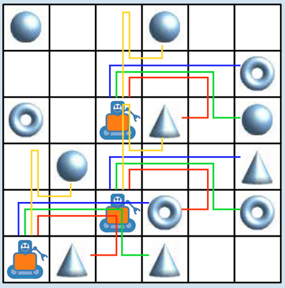

**Zum Beispiel:** Mit den Befehlen N, O, O, S, O steuerst du die Roboter entlang der grünen Linien. Am Ende nehmen sie einen Ball, einen Ring und einen Kegel.

- Nicht richtig: Mit den Befehlen N, O, O, O steuerst du die Roboter entlang der blauen Linien. Am Ende nehmen sie zwei Ringe und einen Kegel.
- Nicht richtig: Mit den Befehlen N, N, S, O, N steuerst du die Roboter entlang der gelben Linien. Am Ende nehmen sie zwei Bälle und einen Kegel.
- Nicht richtig: Mit den Befehlen N, O, O, S, W steuerst du die Roboter entlang der roten Linien. Am Ende nehmen sie zwei Kegel und einen Ring.

## Das ist Informatik!

Die drei Roboter fahren gleichzeitig, also parallel. So können sie die gewünschten Dinge schneller nehmen und dann vielleicht zu einem gemeinsamen Ziel bringen, als wenn sie – oder nur einer von ihnen – nacheinander die Dinge nehmen müssten. Parallel geht es schneller!

Beim Bau von Informatiksystemen wird schon lange auf Parallelität gesetzt. Es gibt große Supercomputer mit vielen Prozessoren, die parallel z. B. Wettersimulationen berechnen, für genaue Wettervorhersagen. Während Supercomputer anfangs als große Maschinen gebaut wurden, werden heute häufig viele kleinere Computer zu einem so genannten Cluster miteinander vernetzt. Parallelität gibt es aber auch auf aktuellen Smartphones, auf deren Chips mehrere Prozessorkerne arbeiten. Die Werbung spricht dann z. B. von Quad-Core (vier Kerne) oder Octa-Core (acht Kerne) Prozessoren.

Wenn alle parallel arbeitenden Prozessoren das Gleiche tun und jeder seine eigenen Daten hat, kommen sie sich nicht in die Quere, wie die drei Roboter. Nach diesem Prinzip wurden früher so genannte Vektorrechner gebaut, und auch in modernen Computer-Clustern erledigen die einzelnen Computer in der Regel alle die gleiche Arbeit. Diese Art von Parallelität ist einfach zu organisieren, aber nur beschränkt einsetzbar. Flexibler sind Parallel-Computer, deren Prozessoren gemeinsame Daten haben bzw. Daten austauschen können. Das ist schwieriger zu organisieren, und der Datenaustausch kostet Zeit. Die Informatik hat aber viele Methoden entwickelt, solche Multiprozessor-Computer effektiv zu steuern.
