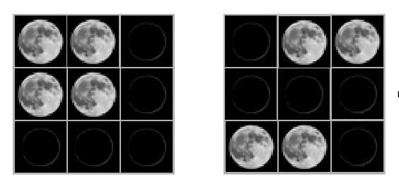

Der weiße Anaxagoras besitzt Mondzauberkarten, die für jedes ihrer neun Felder nach einer festen Regel funktionieren. Bei zwei Karten gibt er in jedes Feld ein Mondsymbol ein: Neumond (dunkel) oder Vollmond (hell). Sofort erscheinen auch Mondsymbole auf einer dritten Karte.

Hier ein Beispiel, links die zwei Eingabekarten, rechts die Ausgabekarte:

Verstehst du die Regel? Dann gestalte die Ausgabekarte zu diesen beiden Eingabekarten. Wähle ein Mondsymbol (dunkel = Neumond, hell = Vollmond) und klicke auf die Felder, bis alle das richtige Mondsymbol zeigen.

