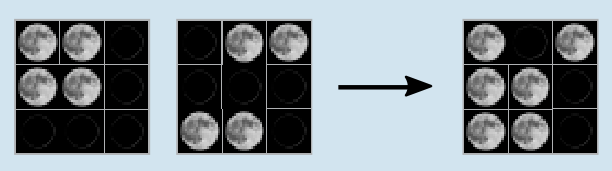

Die Regel ist: Wenn auf den beiden Eingabekarten im gleichen Feld genau einmal Vollmond vorkommt, dann zeigt das entsprechende Feld der Ausgabekarte das Mondsymbol Vollmond, andernfalls das Mondsymbol Neumond.

## Das ist Informatik!

In allen Bereichen der Informatik wird gerne zweiwertige Logik benutzt, um über die Wahrheit und Falschheit von Aussagen innerhalb des Modells einer Anwendung zu entscheiden. Das geschieht immer unter der Voraussetzung, dass es im Modell dafür genau zwei Möglichkeiten (zwei Werte) gibt. Eine dritte Möglichkeit ist ausgeschlossen: *tertium non datur*.

Einige Beispiele für solche Zwei-Werte-Mengen in Modellen sind: {zu, auf}, {kalt, heiß}, {ungerade, gerade}, {leer, voll}, {schwarz, weiß}, {nein, ja}, {0, 1}, {Neumond, Vollmond}. Auf einer solchen Grundlage kann man dann Aussagen innerhalb des Modells logisch miteinander verknüpfen. Eine logische Funktion liefert entweder den Wahrheitswert „falsch“ oder den Wahrheitswert „wahr“. Weil man logische Funktionen miteinander zu neuen logischen Funktionen verknüpfen kann, gibt es davon im Prinzip beliebig viele. In dieser Biberaufgabe benutzen wir die Funktion XOR („ausschließendes Oder“, englisch: „exclusive or“), weil sie besonders häufig vorkommt und leicht zu verstehen ist. XOR funktioniert so: Wenn von einer Anzahl Aussagen genau eine „wahr“ ist und alle anderen „falsch“, dann liefert XOR den Wahrheitswert „wahr“. In allen anderen Fällen liefert XOR den Wahrheitswert „falsch“. Im Beispiel zu dieser Aufgabe wird die logische Funktion XOR neunmal (Felder) mit zwei Aussagen (Eingabekarten) vorgeführt.

Übrigens: Anaxagoras hat als erster erkannt, dass der Mond nicht von sich aus leuchtet. Nun trägt ein Mondkrater den Namen mit dem versteckten XOR.
