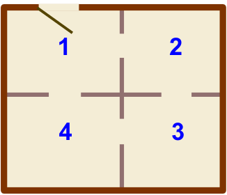

Im Museum für moderne Holzplastiken gibt es ein intelligentes Sicherheitssystem. Das System ermittelt jede Minute, wie viele Personen in jedem Raum sind, und trägt die Zahlen in eine Tabelle ein. Außerdem prüft es anhand der Zahlen, ob ein Eindringling im Museum ist. Ein Eindringling ist eine Person, die in das Museum gelangt ist, aber nicht die Eingangstür benutzt hat.

Sobald das System meint, dass ein Eindringling im Museum ist, schlägt es Alarm.

Unten siehst du die Tabelle des Systems für die Minuten 10:01 bis 10:07. Danach siehst du den Raumplan des Museums mit den Nummern der Räume. Das Museum ist groß: Von einer Minute zur nächsten kann man es höchstens durch eine Tür schaffen.

| Zeit  | Raum 1 | Raum 2 | Raum 3 | Raum 4 |
|-------|-------:|-------:|-------:|-------:|
| 10:01 | 2 | 0 | 0 | 0 |
| 10:02 | 3 | 0 | 0 | 0 |
| 10:03 | 2 | 1 | 0 | 0 |
| 10:04 | 4 | 1 | 1 | 0 |
| 10:05 | 2 | 2 | 3 | 0 |
| 10:06 | 5 | 2 | 2 | 1 |
| 10:07 | 4 | 1 | 2 | 2 |

**In einer der Minuten in der Tabelle schlägt das System Alarm. In welcher?**
