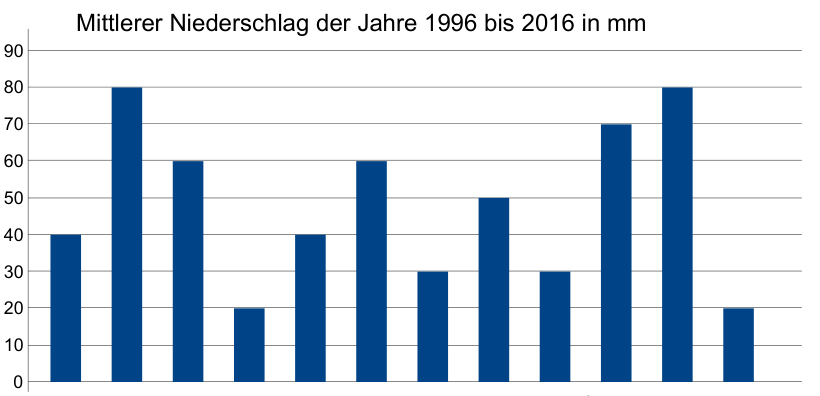

Für einen kleinen Fluss wird ein neuer Damm geplant. Die Ingenieure studieren die Niederschläge (Regen, Schnee, Hagel) der vergangenen 20 Jahre, um den besten Baumonat zu finden. Sie sind sich über die folgenden Bedingungen einig:

- Die maximale Belastung des Damms muss getestet werden, bevor der Damm freigegeben wird.
- Der Damm muss ein oder zwei Monate vor dem Test gebaut werden.
- Der Baumonat sollte möglichst trocken sein.

**Welchen Monat wählen die Ingenieure?**
