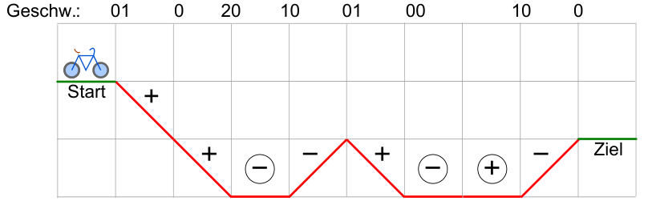

BikeFun ist ein Riesenspaß! Mit speziellen Spaßrädern kann man verschiedene Parcours befahren. Jeder Parcours besteht aus einer Reihe von Abschnitten. Ein Abschnitt verläuft entweder bergab, bergauf oder flach.

**Das Befahren eines Parcours funktioniert nach diesen Regeln:**

- Am Start beträgt die Geschwindigkeit 0 km/h.
- Auf einem Bergab-Abschnitt erhöht das Rad automatisch die Geschwindigkeit um 10 km/h.
- Auf einem Bergauf-Abschnitt verringert das Rad automatisch die Geschwindigkeit um 10 km/h.
- Auf einem flachen Abschnitt kannst du selbst entscheiden und die Geschwindigkeit um 10 km/h entweder erhöhen oder verringern.
- Am Ziel muss die Geschwindigkeit wieder 0 km/h betragen. Auch zwischendurch kann die Geschwindigkeit 0 km/h betragen, aber dann muss sie sofort wieder erhöht werden – sonst ist die Fahrt zu Ende!

Hier ist ein Parcours skizziert, der nach den Regeln befahrbar ist. Dazu kann die Geschwindigkeit auf den flachen Abschnitten so verändert werden, wie in den Kreisen angegeben (+ erhöhen, − verringern).

Hier sind weitere BikeFun-Parcours skizziert. Nur einer von ihnen ist nach den Regeln befahrbar.

**Welcher?**
