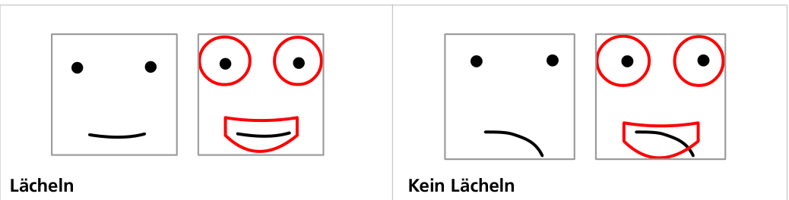

Eine App soll entscheiden, ob ein gezeichnetes Gesicht lächelt. Sie benutzt dazu ein „Lächelmuster“ mit Bereichen für Augen und Mund. Ein Gesicht lächelt, wenn Augen und Mund ins Lächelmuster passen: Augen und Mund müssen komplett in den Bereichen des Musters liegen.

Hier sind vier Gesichter.

**Bei welchem Gesicht entscheidet die App, dass es lächelt?**
