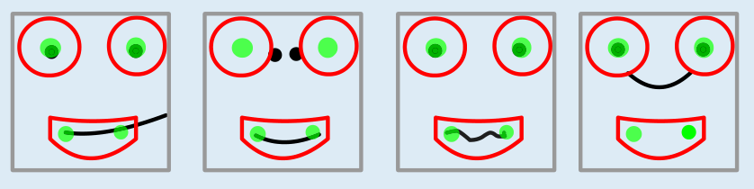

Antwort **C** ist richtig.

Hier sieht man, wie die vier gezeichneten Gesichter mit dem Lächelmuster geprüft werden. Nur bei Gesicht C passen Augen und Mund ins Lächelmuster.

## Das ist Informatik!

Die Informatik entwickelt Softwaresysteme, die in den Bildern einer Videokamera Objekte identifizieren können. Zum Beispiel das Nummernschild eines Autos oder das Gesicht eines Menschen. Das wird mal eine mächtige Technik, bei der auch Methoden der Künstlichen Intelligenz (z. B. Deep Learning) eingesetzt werden. Mit der Anwendung simpler Regeln wird schon experimentiert.

Diese Biberaufgabe zeigt eine der Schwierigkeiten, die ein Bilderkennungssystem immer haben wird: Es gibt keine klare Grenze zwischen Lächeln und Nichtlächeln. Die Regeln sind hier noch viel zu grob. Das Gesicht, das als lächelnd eingestuft wird, lächelt nicht. Solche Fehler passieren auch in Wirklichkeit bei Systemen zur Gesichtserkennung, die zum Beispiel bei automatischen Passkontrollen oder in Behörden eingesetzt werden. 2016 wurde der Pass-Antrag des asiatischen Studenten Richard Lee abgelehnt, weil der Computer auf dem Passbild seine Augen nicht erkennen konnte.
