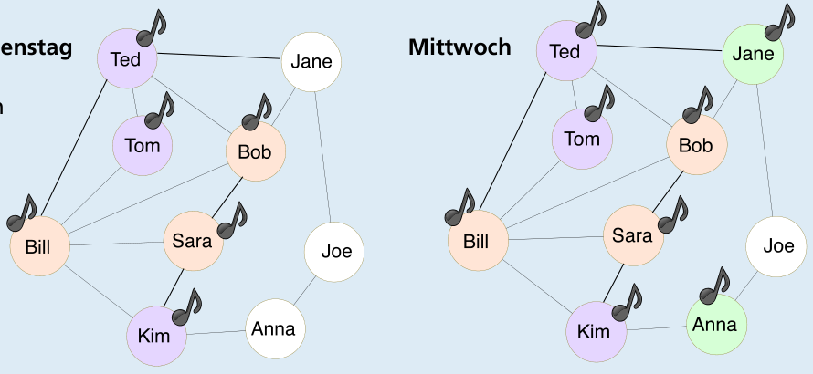

Antwort **B** ist richtig.

Tom, Ted und Kim kaufen den Song am Dienstag, Anna und Jane kaufen ihn am Mittwoch:

Joe kauft daraufhin den Song am Donnerstag. An diesem Tag haben alle in der Klasse den Song; vorher nicht.

## Das ist Informatik!

So genannte „Soziale Netzwerke“ haben manchmal Milliarden Mitglieder. Deshalb sind sie nicht nur für ihre Benutzerinnen und Benutzer interessant, sondern vor allem auch für Anbieter von Produkten. In Marketingkampagnen wird der Diffusionsprozess in sozialen Netzwerken ausgenutzt, um neue Produkte bekannt zu machen. Um diesen Prozess geht es in dieser Biberaufgabe.

Hier wird ein Schwellenmodell verwendet, um die Diffusion zu simulieren. Das Diagramm in der Aufgabe ist ein Graph. Er besteht aus Knoten (Namen von Personen) und Kanten (Linien zwischen den Knoten, die Freundschaften – im Sinne des sozialen Netzwerkes – zwischen Personen darstellen). Knoten, die über eine Kante direkt miteinander verbunden sind, nennt man Nachbarn. Die Infektionsschwelle q ist eine Zahl zwischen 0 und 1. In der Aufgabe ist q = 0,5. Eine Person zeigt ein neues Verhalten B (z. B. Kauf eines Produktes), wenn mindestens der Anteil q ihrer Nachbarn im Graph auch dieses Verhalten B zeigt.
