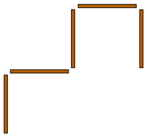
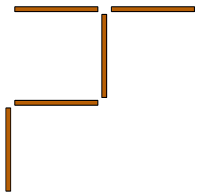

Fünf Hölzchen liegen so auf dem Tisch:

Nola nimmt ein Hölzchen und legt es woanders hin. Jetzt liegen die Hölzchen so:

Danach nimmt Bert ein Hölzchen und legt es woanders hin.

**Wie können die Hölzchen jetzt NICHT liegen?**
