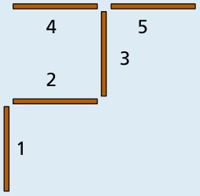

Antwort **D** ist richtig.

Wir geben den Hölzchen Nummern. Nach Nola liegen die Hölzchen so:

- Damit die Hölzchen so wie in Bild A liegen, muss Bert das Hölzchen 1 woanders hin legen.
- Damit die Hölzchen so wie in Bild B liegen, muss Bert das Hölzchen 5 woanders hin legen.
- Damit die Hölzchen so wie in Bild C liegen, muss Bert das Hölzchen 1 woanders hin legen.
- Damit die Hölzchen so wie in Bild D liegen, müsste Bert zwei Hölzchen, nämlich die Hölzchen 1 und 5, woanders hin legen. Er legt aber nur ein Hölzchen woanders hin.

## Das ist Informatik!

Um die Lage der Hölzchen zu verändern, haben Nola und Bert die einfache Möglichkeit, genau ein Hölzchen woanders hinzulegen. Damit verändert sich die Lage der Hölzchen so wenig wie möglich. Wenn ein Freund ihnen sagen möchte, wie sie die Lage der Hölzchen verändern sollen, kann er die folgende Anweisung ein- oder mehrmals benutzen: „Lege ein Hölzchen woanders hin!“ – wobei er auch noch sagen muss, welches Hölzchen und wohin. Weitere Anweisungen, z. B. „Lege zwei Hölzchen woanders hin!“, „Lege drei Hölzchen woanders hin!“ usw. werden nicht benötigt.

Wer Computer programmiert, schreibt sogenannte Anweisungen auf, die der Computer schon kennt und daher ausführen kann. Kompliziertere Anweisungen werden aus den einfachen Anweisungen zusammengesetzt: indem man entweder mehrere Anweisungen hintereinander aufschreibt, oder indem man aufschreibt, dass eine Anweisung mehrfach hintereinander ausgeführt werden soll, oder indem man aufschreibt, dass eine Anweisung nur unter einer bestimmten Bedingung ausgeführt werden soll. Das sind die drei wichtigsten Möglichkeiten, in Computerprogrammen aus (anfänglich einfachen) Anweisungen immer kompliziertere Anweisungen zu machen. Das hört sich doch gar nicht so schwer an!
