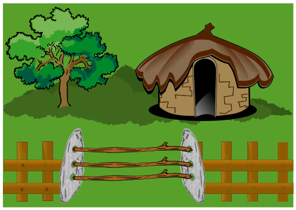

Die Biber besuchen einander oft. Aber … manchmal ist man nicht zu Hause. Dann hinterlässt man an seinem Steinplatten-Gartentor eine Nachricht, wann man ungefähr wieder da ist. Dazu steckt man bis zu drei Holzstäbe gerade zwischen gegenüberliegende Bohrlöcher der Steinplatten.

Die Biber haben diese vier Gartentor-Nachrichten miteinander verabredet:

Die Biber könnten noch weitere Nachrichten verabreden, ohne zusätzliche Holzstäbe oder Bohrlöcher zu verwenden.

**Wie viele?**
